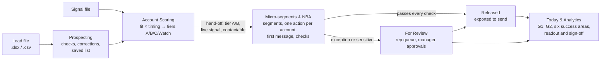
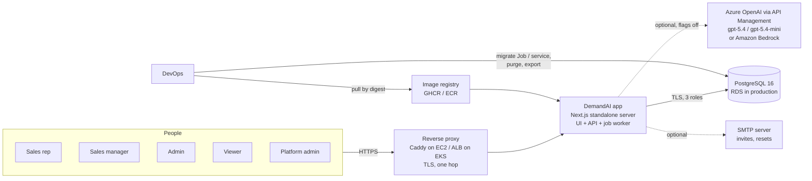
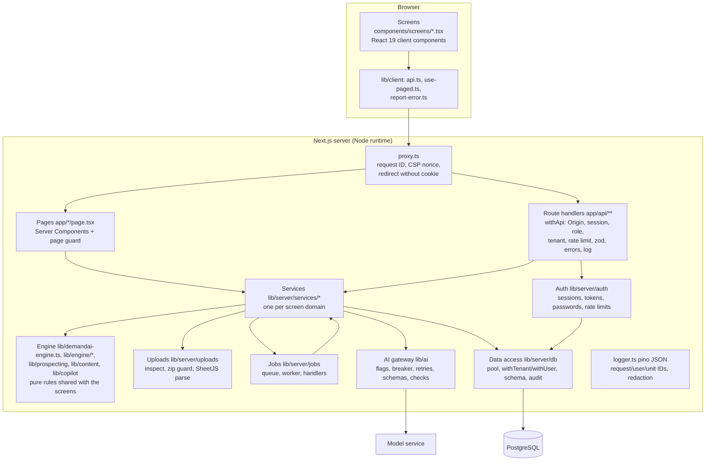
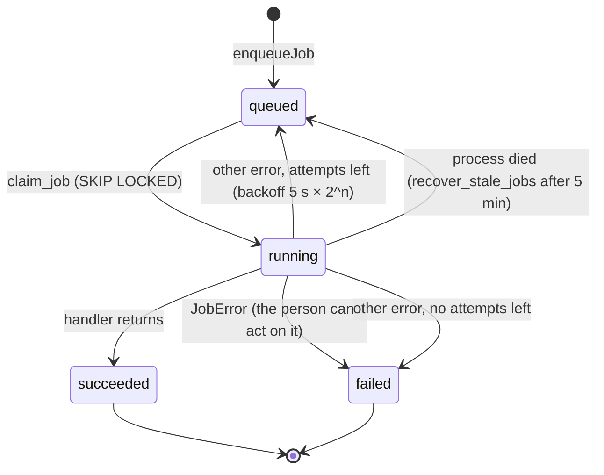
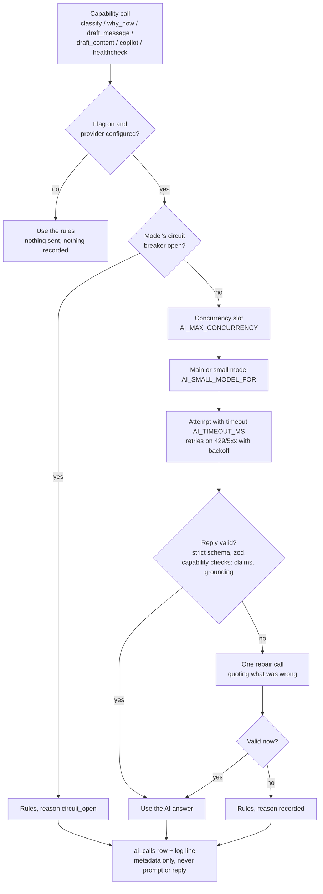
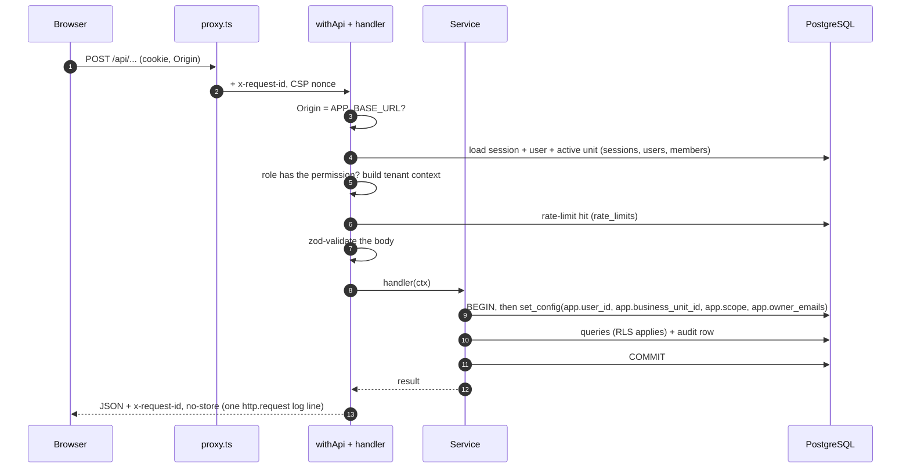
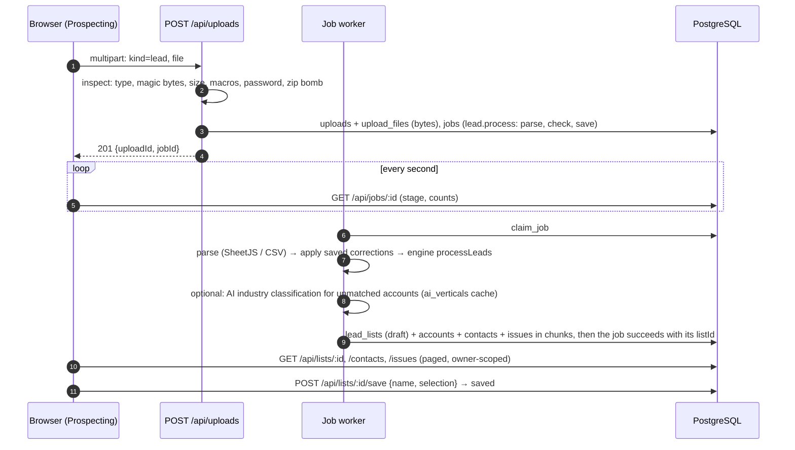
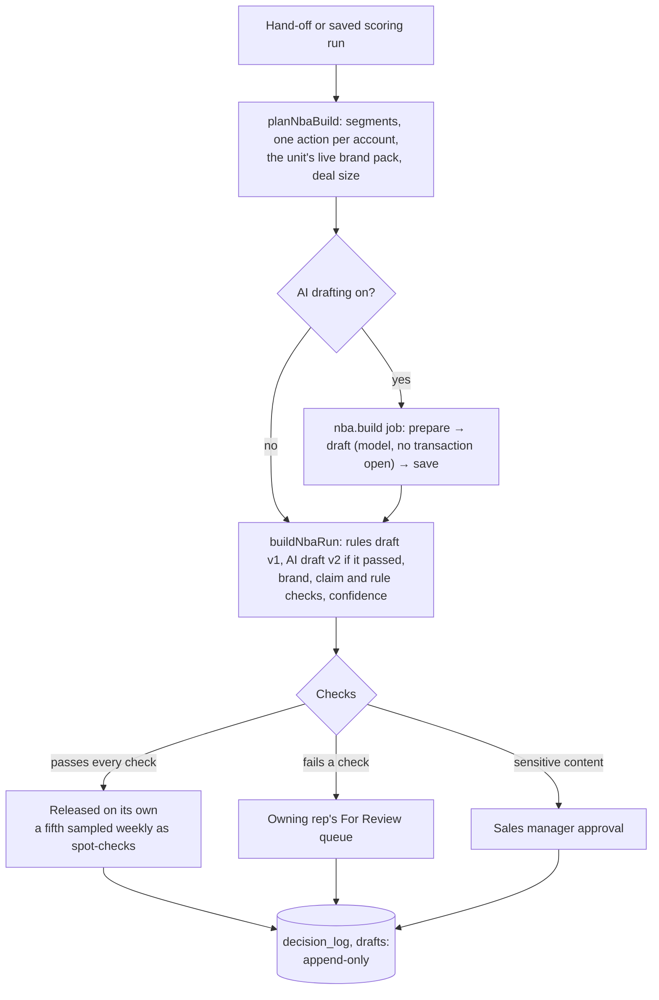
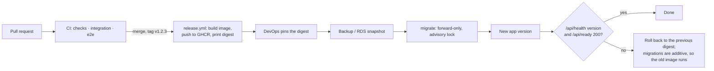

# Architecture

How DemandAI is built: the high-level design (§1–2), the modules (§3), the end-to-end flows (§4), what works (§5), and technical debt and failure points (§6). Written from the code at `a6b4cf0` (25 Oct 2026). Tables, roles and isolation are in [DATA_MODEL.md](DATA_MODEL.md); settings in [CONFIGURATION.md](CONFIGURATION.md); routes in [API.md](API.md); the AI capabilities in [AI.md](AI.md); threats and controls in [SECURITY.md](SECURITY.md); decisions cited as `D-n` in [DECISIONS.md](DECISIONS.md).

Diagrams are Mermaid: GitHub renders them, and so does the Azure DevOps wiki (there inside a `::: mermaid` block).

## 1. What the system does

A B2B sales team works a pipeline in five steps, each a screen, each started by a person (no orchestration, D-42):

Content library (brand pack, approved claims), Content studio (blogs and whitepapers), Copilot (questions about the screen), Setup (configuration, sign-offs, signal switches, AI service) and Users and roles support those steps. Nothing sends a message: released messages and tasks are downloaded as CSV for the team's own tools.

## 2. High-level design

### 2.1 Context

- **One deployable**: a Node 24 container running the Next.js standalone server. It serves the pages, the API and a background job worker in the same process. The same image carries the migration runner, `create-admin`, and the purge and export commands.
- **One database**: PostgreSQL 16 holds everything, uploaded files included (D-7). Isolation per business unit and per owner is enforced in PostgreSQL row-level security as well as in the code (D-32, D-33).
- **No other services**: no cache, queue, object store or search engine. Jobs are rows claimed with `FOR UPDATE SKIP LOCKED`; rate limits and sessions are tables.
- **Optional outbound calls**: a language model (every capability off by default, rules as fallback, D-5), and SMTP (off until a sender is configured; links are copied instead).

### 2.2 Inside the app

Rules that both the screens and the server need (permissions, the engine's labels and checks, Copilot's answer types) live in `lib/` without `server-only`, so the browser shows the same wording the server enforces. Everything that touches the database, secrets or a model imports `server-only` and can't be bundled for the browser.

### 2.3 Deployment topologies

| | Development | EC2 (pilot or dev host) | EKS (production path) |
|---|---|---|---|
| App | `npm run dev` on the host | `app` service of `compose.yaml`, read-only root, no capabilities, loopback port 3100 | Deployment (2 replicas, PDB, NetworkPolicy), Service, ALB Ingress |
| Proxy / TLS | none (http://localhost:3000) | Caddy (`deploy/ec2/compose.proxy.yaml`), Let's Encrypt | AWS Load Balancer Controller, ACM certificate |
| Database | `db` container on 127.0.0.1:55432 (`compose.dev.yaml`) | `db` container, or RDS with `compose.rds.yaml` | RDS for PostgreSQL 16, TLS `verify-full` |
| Migrations | `npm run db:migrate` | `backup` then `migrate` services before `app` | `migrate` Job before the rollout |
| Secrets | `.env.local` | Secrets Manager → `/etc/demandai/demandai.env` by `sync-secrets.sh` (systemd) | External Secrets → three Kubernetes Secrets |
| Scheduled | — | `demandai-backup.timer` (pg_dump) | purge CronJob (dry run until `--yes`) |

Details and the rehearsal record: [devops/](devops/README.md). Nothing has been deployed to AWS yet (D-37: DevOps deploys).

### 2.4 Integrations

| Integration | Direction | Protocol | Code | Off switch |
|---|---|---|---|---|
| PostgreSQL 16 | out | TCP 5432, TLS per `DATABASE_SSL_MODE` | `lib/server/db/pool.ts`, `scripts/db/*` | — (required) |
| Azure OpenAI / API Management | out | HTTPS, `openai` 7.34.0, chat completions, structured outputs | `lib/ai/providers/azure-openai.ts` | `AI_PROVIDER=none` or the `AI_FEATURE_*` flags |
| Amazon Bedrock | out | HTTPS, Converse API, IAM role | `lib/ai/providers/bedrock.ts` | as above |
| SMTP | out | STARTTLS, nodemailer 10.1.0 | `lib/server/mail/mailer.ts` | `NOTIFICATION_DISABLED=1` |
| Google Fonts | build time only | HTTPS | `next/font/google` in `app/layout.tsx` | — (the build needs network) |

## 3. Low-level design: the modules

### 3.1 Edge: `proxy.ts`, `next.config.ts`, `instrumentation.ts`

- `proxy.ts` (Next 16's replacement for middleware) runs before every page and API request except static files, `/api/health`, `/api/ready` and `/api/uploads` (large bodies go straight to their handler, N-06). It sets `x-request-id`, builds a Content Security Policy with a fresh nonce (`lib/security/csp.ts`), and redirects a page request without a `demandai_session` cookie to `/login?next=…`. It never decides access.
- `next.config.ts` sends HSTS, `nosniff`, `X-Frame-Options: DENY`, `Referrer-Policy: same-origin`, a Permissions-Policy and COOP/CORP on every response; output is `standalone`.
- `instrumentation.ts` runs once per server process: `boot()` validates the configuration (exit 1 with the variable names on failure) and logs what is configured; then `startJobWorker()`; and `onRequestError` logs unhandled errors without query strings or headers.

### 3.2 Pages and screens

`app/<screen>/page.tsx` is a Server Component: it reads the session (`lib/server/auth/page.ts`), redirects to sign-in when there is none, renders a "not available" frame when the role can't open the screen (`PAGE_ACCESS`), and otherwise renders `components/screens/<Screen>Screen.tsx` inside `components/AppShell.tsx` (navigation, business-unit switcher, Copilot panel). The screen is a client component that calls the API through `lib/client/api.ts` and pages long lists with `lib/client/use-paged.ts` (keyset, "Show more"). The look was ported character for character from `legacy/` (`lib/sx.ts` turns the prototype's inline styles into React style objects). The browser keeps only three UI preferences in `localStorage`; no data.

### 3.3 API layer: `withApi()`

Every route handler is `withApi({ route, auth, permission?, body?, limit? }, handler)` (`lib/server/http/api.ts`), which in order: takes or makes a request ID and binds it to every log line; refuses a state-changing request whose `Origin` isn't the app's (CSRF); loads the session from PostgreSQL (unless `public`); requires an active business unit and checks the role's permission (403 naming the reason); builds the tenant context (`scope: 'own'` plus owner emails for reps, `'all'` otherwise); counts the call against the route's per-person rate limit (429 with `Retry-After`); reads a size-capped JSON body and validates it with zod; runs the handler; maps `HttpError` to `{error, code, requestId}` and anything else to a generic 500; and writes one `http.request` access line. Each handler exposes its policy (`apiPolicy`) so the HTTP tests can compare the real routes with the inventory.

### 3.4 Sign-in, sessions and access (`lib/server/auth`, `services/auth.ts`, `services/users.ts`, `services/platform.ts`, `lib/auth/permissions.ts`)

- Invite-only (D-3): an Admin or Sales manager invites (`POST /api/users`); the person opens a one-time link (token in the URL fragment, 72 h for invites, 30 min for resets, only its SHA-256 stored) and sets a password (bcrypt cost 12, length and common-password rules).
- Sign-in counts failures per address and per email (pseudonymised with `SESSION_SECRET`), and 5 wrong passwords in a row lock the account for 15 minutes. A session is a `sessions` row; the cookie holds `<id>.<HMAC>`; it ends after 12 h, or 60 idle minutes, or at sign-out, reset or deactivation (re-read on every request).
- Roles are per business unit (`business_unit_members`): Admin, Sales manager, Sales rep, Viewer. The platform administrator is a flag on the user and manages units only. `ACTIONS` lists what each role may do; the screens use the same table to hide what a role can't use.

### 3.5 Data access (`lib/server/db`)

- `pool.ts`: one `pg.Pool` per process, kept on `globalThis` (Next bundles server code into several chunks), with TLS per `DATABASE_SSL_MODE`, `statement_timeout`, a 60 s idle-in-transaction timeout, error listeners and a clean close on SIGTERM.
- `tenant.ts`: every query runs inside `withTenant(db, ctx, fn)` (unit work) or `withUser(db, ctx, fn)` (sign-in, choosing a unit, platform work). Both open a transaction and `set_config(…, true)` the user, unit, scope and owner emails; the RLS policies read them through `app_bu()`, `app_scope_all()`, `app_owns()` and fail closed without them. `inOtherUnit()` is the one place work crosses units (moving an account, D-34). Transactions slower than 500 ms log `db.transaction.slow`.
- `schema.ts`: the Drizzle schema (47 tables). DDL is generated into `drizzle/`; RLS policies, triggers, grants and functions are hand-written migrations beside it.
- `audit.ts`: audit rows are written in the same transaction as the change they describe.

### 3.6 Services (`lib/server/services`)

One module per screen domain; each takes a `TenantScope` and an actor, applies the business rules, filters by owner where it applies (`ownerOnly()`), and writes audit or decision-log rows in the same transaction.

| Module | Responsibility |
|---|---|
| `uploads.ts`, `lists.ts`, `corrections.ts`, `mappings.ts` | Receive and store files; the lead job (parse → check → save) building a draft list; paged reads, CSV reports; save, rename, delete; corrections replayed on every rebuild; saved column mappings |
| `scoring.ts`, `signal-monitoring.ts`, `why-now-ai.ts` | Scoring runs as jobs (parse → check → score → save), prospects and signals paged, the signal monitoring tab, AI why-now lines for tier A and B |
| `handoffs.ts`, `routing.ts` | The hand-off of contactable tier A/B prospects (G-005), routing rules (owner and target unit), account transfers between units |
| `nba.ts`, `nba-ai.ts`, `recommendations.ts` | Micro-segment builds: segments, one action per account, the first message drafted and checked, routing to released / rep queue / manager; AI drafts as a job; one recommendation's detail, drafts and log |
| `review.ts`, `autopilot.ts` | For Review: queue, accept / reject / hold / fix / step in / teach, manager approval and send-back, reassign, weekly spot-checks, exports; Autopilot (low-risk only, logged, undoable) |
| `today.ts`, `analytics.ts`, `measures.ts` | Today's blockers and work; Analytics: the six success areas, G1 and G2, funnel, evidence, weekly summary, readout and sign-offs |
| `setup.ts`, `brand.ts`, `studio.ts` | Configuration versions, sign-offs and signal switches; the brand pack (versions, draft, claims, documents); Content studio pieces and their chat |
| `copilot.ts`, `industry-ai.ts`, `ai-admin.ts` | Copilot (rules first, then the model with tokens for people); AI industry classification inside the lead job; the AI service page and health check |
| `auth.ts`, `users.ts`, `platform.ts` | Sign-in and links; users, roles, aliases, history; business units |

### 3.7 The engine (`lib/demandai-engine.ts`, `lib/engine/*`, `lib/prospecting/*`, `lib/content/*`, `lib/copilot/*`)

Deterministic, pure TypeScript, no I/O, shared by the server and the screens, and pinned by tests: the answer key (`tests/answer-key.test.ts`, per-scenario floors and a tier snapshot over the fictional 7,498-row sample), parity with the legacy engine (`tests/engine-parity.test.ts`, listing the fixes the legacy still has as defects), and the legacy engine's own 37 tests.

| Module | Rules |
|---|---|
| `lib/demandai-engine.ts` | Lead discovery stages 1–5 (column mapping, normalisation of countries, emails, LinkedIn, account types, consent; duplicates; persona; industry and ICP; contactability `canContact`; suppression) and scoring stages 6–8 (signal checks and synonyms, matching by domain or name, fading weights, fit × timing score 0–100, tiers at 35 (A) and 20 (B), C below with a live signal, Watch for a good fit with none). `ENGINE_VERSION` names the rule set |
| `lib/engine/config.ts` | Configuration v1 as JSON (regular expressions as `{regex, flags}`), stored per unit in `config_versions` |
| `lib/engine/prospects.ts` | The ranked prospects of a run (tier, score, fit) that every screen and the hand-off read |
| `lib/engine/nba.ts` | Stage 9: micro-segments, the playbook, deal size, channel choice (`allowedChannels`), the brief, proof points, drafts and their checks, confidence |
| `lib/engine/review.ts` | A recommendation's life after the build: states, exceptions, the four checks, reject codes R1–R12 (each decides what comes back), due dates, follow-ups |
| `lib/engine/routing.ts`, `gates.ts`, `corrections.ts`, `sheets.ts` | Routing rules; G1/G2 and readiness; correction fields and replay; picking the sheet of a workbook |
| `lib/prospecting/checks.ts`, `quality.ts` | The check panes and their grouping; % clean and readiness |
| `lib/content/brand.ts`, `studio.ts` | Brand-pack changes and claim status; the Content studio's rules writer |
| `lib/copilot/rules.ts`, `due.ts` | Copilot's rule answers; due dates in the viewer's time zone |

### 3.8 Uploads (`lib/server/uploads`)

`inspect.ts` checks a file before anything parses it: extension and magic bytes agree (.csv, .xlsx, .xls), size cap, no macros, no password, no zip bomb (`zip.ts` inflates every entry under a hard cap; ZIP64 and encrypted entries refused). `parse.ts` reads it with SheetJS 0.20.3 (the official tarball, D-24) with `cellDates` off: a date cell becomes `YYYY-MM-DD` from the serial number, so no time zone moves it a day (G-024); formulas are never evaluated. The bytes are stored in `upload_files`, so a list can be rebuilt from its upload later.

### 3.9 Jobs (`lib/server/jobs`)

`enqueueJob()` inserts a `jobs` row (kind, payload of IDs only, stages) in the caller's transaction and wakes the local worker. Every server process runs one worker (unless `JOBS_WORKER=0`) that claims one job at a time through `claim_job()` (`FOR UPDATE SKIP LOCKED`, so replicas share the queue), runs it as the System user in the job's unit, and reports each stage in its own short transaction so the screen sees progress. Kinds: `lead.process`, `scoring.run`, `nba.build`.

A job's time limit is `UPLOAD_TIME_LIMIT_MS` (60 s), and 6 minutes for an AI-written build; slow optional work (model calls) stops at the deadline so the job still finishes with the rules.

### 3.10 AI gateway (`lib/ai`, `lib/server/ai.ts`)

One server-only door to a model (D-5, D-35, D-44); nothing else imports a model SDK (a test checks). Per call:

People are never sent by name: Copilot sees tokens (`P1`, `R1`) that are put back on screen; drafts get job titles, classification only the industry texts. Uploaded text sits inside delimiters with instructions to treat it as data (SECURITY.md T7).

### 3.11 Logging, mail, security headers

- `logger.ts`: pino JSON to stdout; an `AsyncLocalStorage` context adds request, user and unit IDs to every line; sensitive keys redacted and email addresses masked anywhere. Event names (`http.request`, `job.failed`, `ai.call`, `auth.sign_in.locked`, …) are listed in [devops/OBSERVABILITY.md](devops/OBSERVABILITY.md).
- `mail/`: plain emails for invites, resets and "password changed"; recipients never logged; with email off, the link is returned to the Admin's screen.
- `lib/security/csp.ts`: scripts only with the per-request nonce (`strict-dynamic`), style elements with the nonce, style attributes allowed, `frame-ancestors 'none'`.

### 3.12 Scripts and the image

| Script | Role | Runs |
|---|---|---|
| `scripts/db/migrate.mjs` | Applies `drizzle/` in journal order, one transaction per file, under an advisory lock; a changed applied migration is an error | owner role; Compose `migrate`, Kubernetes Job, `npm run db:migrate` |
| `scripts/db/seed.ts` | Two fictional units, seven users, aliases, config v1; idempotent; refuses production | owner role; development only |
| `scripts/users/create-admin.mjs` | First Admin of a unit or the platform admin; prints a 72-hour link | owner role |
| `scripts/data/purge.mjs`, `export.mjs` | End-of-pilot purge (dry run unless `--yes`) and export (original files + JSON Lines) through `SECURITY DEFINER` functions | ops role |
| `scripts/ai/evaluate.ts`, `diagnose.mjs` | Live evaluation on the fictional sample; endpoint diagnostic | needs `AI_LIVE_SMOKE=1` for live calls |
| `scripts/audit-gate.mjs`, `check-dependency-age.mjs`, `check-bundle-secrets.mjs` | CI gates | CI and locally |
| `scripts/dev/init-env.mjs` | Writes `.env.local` with random local secrets | development |

The `Dockerfile` builds in three stages (deps with `npm ci`, build, runtime) on `node:24.22.1-alpine3.23` pinned by digest; the runtime holds the standalone server, static assets, `drizzle/` and the ops scripts, runs as uid 10001 with a health check on `/api/health`.

## 4. Application flows

### 4.1 A request

### 4.2 Sign-in

1. An Admin invites a person (`POST /api/users`): a `users` row (invited), a membership with a role, an `email_tokens` row (hash only), an audit entry; the link is emailed, or shown to copy while email is off.
2. The person opens `/accept-invite#token=…` and sets a password (`POST /api/auth/accept-invite`): the token is used once, the user becomes active, a session is created.
3. Later sign-ins: `POST /api/auth/login` → rate limits → bcrypt check (a dummy check for unknown emails, so timing doesn't reveal accounts) → lockout counters → `sessions` row → `Set-Cookie: demandai_session=<id>.<hmac>; HttpOnly; SameSite=Lax`. The person lands on their role's first screen; `POST /api/session/business-unit` switches the active unit.

### 4.3 Lead file to saved list (Prospecting)

A correction (`POST /api/lists/:id/corrections`) is appended to `corrections` and queues a rebuild of the same upload with every correction replayed; the new version keeps the name and selection, and the old one is kept (status replaced) only if runs were made on it. A recheck with a new column mapping does the same.

### 4.4 Scoring, hand-off and routing

1. `POST /api/scoring-runs {listId, signalUploadId, asOf}`: the as-of date is validated (G-061), the active configuration's signal settings (`signalsOff`, `signalsCustom`) are copied onto the run, and a `scoring.run` job is queued (parse → check → score → save).
2. The job reads the signal file, runs `processSignals` (types and synonyms, dates, matching by `company_domain` or name, the person's opt-out) and `scoreList` (fit × timing, tiers), writes `signals`, `account_scores`, `prospect_scores` and `issues`, and, with the flag on, has the model word a why-now line for tier A and B (the rules' line stays as fallback and is shown underneath).
3. `POST /api/handoffs {runId, contactIds?}`: only prospects the caller can see, with a live signal, who pass `canContact` (consent, opt-out, managed separately, D-17), become `handoff_items`, each with its own UUID (G-049); routing rules fill a missing owner. The rest stay in Scoring, counted as held back.
4. A manager may move an account to another unit (`POST /api/accounts/:id/transfer`, manager role in both): its rows and corrections are copied as a lead file that arrives as a saved list in the other unit, recorded in `account_transfers`.

### 4.5 Micro-segment build and routing of each recommendation

The build is stamped with the configuration and brand versions it used; the system's output on `recommendations` is immutable, and only the decision columns are updatable (column-level grants).

### 4.6 For Review and outcomes

The queue (`GET /api/review/queue`) shows a rep their own exceptions and a manager the team's and the sensitive items. Each decision (accept, reject with one of the codes R1–R12, hold, choose the runner-up or an own action, fix, step in, teach) is one append-only `decision_log` row, timed by the server from when the person opened the item. Managers approve or send back sensitive items and check flagged decisions. Released messages and tasks are exported as CSV (`/api/exports/*`); outcomes (Sent, Replied, Meeting booked, No response) are recorded later on the item.

### 4.7 Today, Analytics and the readout

Every number is computed on request from stored rows (no cached metrics): G2 is first-pass acceptance over counted decisions (threshold 70%), G1 is person-minutes per released item against the 38-minute baseline (threshold 50%), both "too early to call" below the agreed number of decisions (D-21). The six success areas (D-38) show their evidence; an Admin or Sales manager records a verdict per area and the sponsor's decision (`readout_signoffs`), which also starts the retention clock (D-20). Reps see their own results, Viewers aggregates only.

### 4.8 Content, Studio and Copilot

- **Content library**: the brand pack (voice, negative keywords, approved claims with owner and expiry, frameworks, a guideline document) is edited as a per-unit draft and saved as a new append-only version; every draft check reads the version a build used.
- **Content studio**: blogs and whitepapers written by the rules writer (`lib/content/studio.ts`) from a brief and the live brand pack, or by the model when its flag is on, checked by the same brand and claim checks, changed by chat or by hand (plain-text blocks with a revision guard), exported as Markdown or Word.
- **Copilot**: `POST /api/copilot` loads the facts of the screen the person is on (owner-scoped), answers from `lib/copilot/rules.ts` when a rule matches, and only otherwise asks the model within row budgets with the last 8 turns. Answers are data rendered as React elements, never markup. Autopilot does only what a person approved there, on low-risk items, logged and undoable.

### 4.9 Release, migration and rollback

### 4.10 End of the pilot

`npm run data:export` returns the original files and every table's rows as JSON Lines with a manifest; `npm run data:purge -- --due` shows what is due (dry run) and `--yes` deletes it in one transaction as the ops role, keeping the audit log, AI call metadata, readouts and sign-offs, configuration, brand packs, Content studio pieces and users ([RUNBOOK.md](RUNBOOK.md) §5).

## 5. What works

Verified on 25 Oct 2026 at `a6b4cf0` by the project's own gates (lint, typecheck, 270 unit tests + 4 skipped, 37 legacy, 162 integration, 31 HTTP, 20 end-to-end, audit, dependency age, bundle secret scan, deployment files, gitleaks), and in the development database (§3 of [handover/REPOSITORY-AUDIT.md](handover/REPOSITORY-AUDIT.md)):

- Sign-in by invitation, roles per unit, owner scoping, lockout, resets; every route tested with every role.
- Prospecting on files up to 25 MB / 50,000 rows (20,000 rows checked in about 5 s and scored in about 3 s on a development machine), corrections, column mappings, saved lists shared in the unit.
- Scoring with signal switches, monitoring, the tier explainer; hand-off that only passes contactable people; routing rules and transfers.
- Micro-segments with drafts, checks and routing; For Review with every decision kind, approvals, spot-checks and exports; Today; Analytics with G1/G2, the six areas and the readout.
- Content library, Content studio, Copilot and Autopilot; Setup with versioned configuration and sign-offs; Users and roles; Platform.
- AI capabilities on gpt-5.4 / gpt-5.4-mini through the pilot's gateway, evaluated live on the fictional sample (every target met, [AI.md](AI.md) §4), each off by default.
- Purge and export, backup and restore, migration and rollback (rehearsed locally between two image tags).

The gaps the audit found and where each stands: [GAP-STATUS.md](GAP-STATUS.md) (63 of 65 fixed, 6 of them provisional; 2 deferred). What the pilot does not do and what is still to agree: [KNOWN-LIMITATIONS.md](KNOWN-LIMITATIONS.md).

## 6. Technical debt and failure points

### 6.1 Technical debt (verified in the code)

| Item | Where | Effect | Suggested fix |
|---|---|---|---|
| `LOG_SLOW_QUERY_MS` is validated and documented but never read; the slow-transaction threshold is a literal 500 ms | `lib/server/env.ts`, `lib/server/db/tenant.ts` | Changing the variable does nothing | Pass `env().LOG_SLOW_QUERY_MS` into `withTenant`/`withUser`, or drop the variable |
| `AZURE_OPENAI_EMBEDDING_DEPLOYMENT` is validated but unused | `lib/server/env.ts`, `.env.example` | Misleading setting | Drop it until a capability uses embeddings |
| Code comments and docs cite local-only documents ("plan §n", "remediation prompt §n", "spec n.n") | 58 and 28 references in tracked files | A new developer can't follow them | [DECISIONS.md](DECISIONS.md) explains the IDs; replace the section references over time |
| `package.json` still describes "a clickable prototype" | `package.json` | Cosmetic | Update the description |
| Pre-remediation artefacts tracked: `docs/ui-map/` (221 screenshots), `docs/replit-*.md` (briefs for the prototype), `test reports/` (a QA PDF of the prototype page) | repository | Noise in a hand-over; not referenced anywhere | Move to an archive or drop from the hand-over repository ([handover/REPOSITORY-AUDIT.md](handover/REPOSITORY-AUDIT.md)) |
| Uploaded files kept in PostgreSQL (`bytea`) | `upload_files` (D-7) | Database size grows with files; fine for a pilot | Object storage with the same retention after the pilot (ADR 0001) |
| Job worker in the web process | `instrumentation.ts` | A 20,000-row job uses about 0.7 GB in the same process that serves pages | Run a worker-only replica (`JOBS_WORKER=0` on the web replicas) when volume grows |
| Circuit breaker and concurrency limit per process | `lib/server/ai.ts` | With N replicas the gateway sees up to N × `AI_MAX_CONCURRENCY` calls | Size `AI_MAX_CONCURRENCY` per replica count |
| One large engine module ported from the prototype | `lib/demandai-engine.ts` (1,127 lines) | Hard to change safely without the answer-key and parity tests | Keep the tests as the guard; split by stage when the rules change |
| End-to-end specs depend on each other's data (run in file-name order) | `e2e/` | One failing spec cascades | Acceptable for the suite's size; isolate if it grows |
| Fonts downloaded at build time | `next/font/google` | The image build needs internet access | `next/font/local` with committed files for air-gapped builds |
| Commit `32f5569` doesn't build on its own | git history | Only matters to someone building that exact commit | None (fixing needs a history rewrite) |
| CI has never run on a hosted runner | `.github/workflows/` | The gates are proven locally only | Push and let CI run before merging ([handover/NEXT-STEPS.md](handover/NEXT-STEPS.md)) |

### 6.2 Failure points at runtime

| Failure | What people see | Built-in behaviour | Where to look |
|---|---|---|---|
| PostgreSQL down or slow | Every screen fails (sessions are read from the database on each request) | `/api/ready` 503 `database: down`; pool errors logged, never fatal | [RUNBOOK.md](RUNBOOK.md) §1 |
| Migrations not applied | The new build can't serve | `/api/ready` 503 `migrations: pending`; the old image still runs on a newer schema | [devops/REDEPLOY.md](devops/REDEPLOY.md) |
| Invalid configuration | The process doesn't start | `config.invalid` names the variable | §2 of [CONFIGURATION.md](CONFIGURATION.md) |
| `APP_BASE_URL` not the public URL | Every save refused with 403; wrong links in emails | CSRF Origin check | `http.request` 403 lines |
| `TRUSTED_PROXY_HOPS` wrong, or the app reachable without the proxy | Per-address sign-in limits can be dodged | Per-email limit and lockout still hold | [SECURITY.md](SECURITY.md) S5 |
| Model service slow, rate-limited or failing | Fewer AI-worded items; screens say how many | Retries, breaker (5 failures → 60 s of rules), deadline, rules fallback | **Setup › AI service**, `ai.call` lines |
| A process dies mid-job | The job's stage stops moving | Re-queued after 5 minutes, up to its attempts | `job.recovered`, [RUNBOOK.md](RUNBOOK.md) §2 |
| No worker running (`JOBS_WORKER=0` everywhere) | Uploads stay "queued" | none | `job.worker.off` at start-up |
| Very large file | Refused before storage (size, rows, unzipped size) | Limits per `UPLOAD_*` | `upload.refused` |
| Missing tenant settings in a query | Empty results rather than another unit's data | RLS fails closed | integration security tests |
| `SESSION_SECRET` rotated | Everyone is signed out | by design | [devops/SECRETS.md](devops/SECRETS.md) |
| SMTP not configured | Links must be copied by the Admin | copy-link fallback | `config.warning` |
| Owner emails in the lead file match no user | A rep sees no accounts | Managers see everything and add aliases | [RUNBOOK.md](RUNBOOK.md) §3 |
