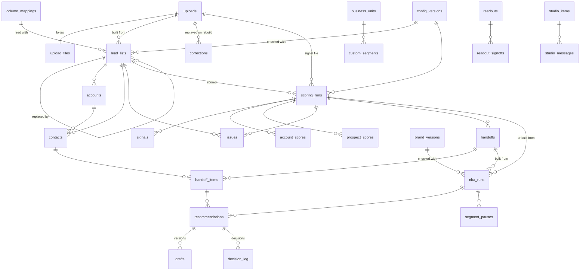

# Data model

PostgreSQL 16, 47 tables, defined in `lib/server/db/schema.ts` and created by the forward-only migrations in `drizzle/` (39 so far). This document says what each group of tables holds, who may read and write it, and how the database enforces that. Column-level detail is in the schema file, with a comment on most tables.

## Roles and isolation

| Role | Does | Can't |
|---|---|---|
| `demandai_owner` | Owns the schema; runs migrations and owns the `SECURITY DEFINER` functions | Not used by the running app |
| `demandai_app` | The app at runtime: `SELECT`/`INSERT`/`UPDATE` where granted, always under row-level security | Change the schema; bypass row-level security; update or delete append-only rows |
| `demandai_ops` | The purge and export functions only (`purge_pilot_data`, `export_pilot_files`, `export_pilot_rows`, `pilot_retention`) | Read tables directly |

Every request runs in a transaction that sets `app.user_id`, `app.business_unit_id`, the caller's scope (`all` or `own`) and their owner emails (`withTenant()` in `lib/server/db/tenant.ts`). Row-level security reads them through `app_bu()`, `app_user()`, `app_scope_all()`, `app_owner_emails()` and `app_owns()`, and fails closed when they are missing. The services filter the same way, so isolation holds twice; tests prove each layer alone holds (`tests/integration/security.test.ts`, `owner-scoping.test.ts`).

- **Business unit** (D-32): every unit-owned table has `business_unit_id NOT NULL` and a policy limiting rows to the active unit.
- **Owner** (D-33): on accounts, contacts, signals, issues, corrections, account and prospect scores, hand-off items, recommendations and spot-checks, a rep (scope `own`) sees only rows whose `owner_email` is theirs or an alias; managers and Admins (scope `all`) see the unit.
- **Append-only** (marked † below): `BEFORE UPDATE OR DELETE` and `BEFORE TRUNCATE` triggers refuse changes, and the app role has only `SELECT, INSERT`. The one exception is the ops role inside the end-of-pilot purge (migration 0037).

## The tables

### Identity and access

| Table | Holds |
|---|---|
| `users` | People and the System user: email (citext), name, status (invited, active, deactivated), platform-admin flag, bcrypt password hash, lockout counters |
| `business_units` | The units of one deployment (D-32) |
| `business_unit_members` | A person's role in a unit (Admin, Sales manager, Sales rep, Viewer) and manager; a person can be in several units |
| `user_owner_aliases` | Extra owner emails a rep owns (the `owner_email` values in the Client's files) |
| `user_role_history` † | Every role, manager, alias, status and platform change, with who and why |
| `sessions` | Database sessions (the cookie holds an HMAC-signed ID), active unit, expiry |
| `email_tokens` | Invite and reset links: SHA-256 of the secret only, single use, expiring |
| `rate_limits` | Sliding-window counters for sign-in, uploads, scoring, builds, studio, Copilot and the health check |
| `audit_log` † | Who did what, when, in which unit, with the request ID (sign-ins, invites, roles, configuration, brand, exports, transfers, sign-offs, AI health checks) |

### Configuration

| Table | Holds |
|---|---|
| `config_versions` | The engine configuration per unit, versioned; every list and run names the version it used. Since 30 Oct 2026 its body also holds the editable scoring settings, the scoring lock and the action library (D-48, D-49) |
| `config_signoffs` † | Setup sections signed off or reopened, by whom, against which version (sections: scope, rubric, personas, signals, actions, segments, measurement, brand, users; migration 0048) |
| `signal_type_changes` † | Signals switched on or off (with the reason), types added or removed |
| `config_changes` † | Each Setup change in words, before and after, by kind: `validation` (the measurement and proceed criteria), `scoring` (rubric, tiers, personas, knock-outs, signal weights), `lock` (the scoring lock), `actions` (the action library) |
| `routing_rules` | Owner and target-unit rules by country, vertical and tier (D-34); audited |
| `column_mappings` | Saved column mappings for files that don't use the template's headers |

### Uploads, lists and corrections

| Table | Holds |
|---|---|
| `uploads` | One per file received: kind (lead or signal), size, checks, the unit, who |
| `upload_files` | The file's bytes (D-7: up to 25 MB, kept in PostgreSQL with the same retention as the rows) |
| `lead_lists` | A checked list: draft, saved or replaced; its quality figures and configuration version |
| `accounts`, `contacts` | The list's accounts and people as the engine built them, with `owner_email` for scoping |
| `issues` | What the checks found per row (D-codes), for the check panes and the validation report |
| `corrections` † | Row edits with reason and source (G-015), replayed on every rebuild of the upload |
| `signals` | Signal rows read for a scoring run, with their outcome (qualified, rejected with a code) |

### Scoring, hand-off and routing

| Table | Holds |
|---|---|
| `scoring_runs` | A scoring of a list with a signal file as of a date, the configuration and signal settings it used, its statistics |
| `account_scores`, `prospect_scores` | Fit, timing, score and tier per account and per person; the why-now line (rules, and AI when on) |
| `handoffs`, `handoff_items` | Tier A and B people handed to Micro-segments & NBA, each with its own UUID (G-049); contactable only (G-005) |
| `account_transfers` † | Accounts moved to another unit, readable by both units (D-34) |

### Micro-segments, decisions and review

| Table | Holds |
|---|---|
| `nba_runs` | A build: its source, segments, statistics |
| `recommendations` | One per account: the system's output (immutable) and the current decision state (the only columns the app may update) |
| `drafts` † | Every version of a message (rules, AI, a person's edit), with its checks |
| `decision_log` † | Every decision: accept, reject with code, hold, approve, send back, step in, outcomes; G1 and G2 are measured from it |
| `segment_pauses` † | Micro-segments paused and resumed |
| `micro_segments` † | Every micro-segment the AI or a person created (D-47): a name unique in the unit, its theme and why, origin (`ai`, `person`), status (`waiting` for a sales manager's approval, `approved`, `retired`), what it was merged into, its former names (a rename or merge moves its items, and older builds show them under the name it has now), who decided and when. Rows are never deleted; the app may update only the decision columns. A person's segment is approved at once and may hold fewer than 3 accounts; the AI's forms only from 3. The rules' starting segments are not rows here |
| `custom_segments` † | The person-made segments from before 30 Oct 2026, copied into `micro_segments` by migration 0047; no longer written |
| `spot_checks` | The weekly sample of items that went ahead on their own, and their ratings |
| `review_views` | When each person last saw their queue (for decision timing) |
| `autopilot_runs` | Copilot's Autopilot runs and their undo (update granted only for undo) |
| `copilot_chats`, `copilot_messages` | Copilot's saved chats: one person's conversation about a screen's record (list, run, build, item or queue) and its questions and answers, with the prospect or item picked for each question. Private to that person (row-level security on the creator), deletable by them; a chat goes with the record it is about, and the purge removes the rest by date |

### Content and measurement

| Table | Holds |
|---|---|
| `brand_versions` †, `brand_drafts`, `brand_documents` | The brand pack per unit (voice, keywords, claims with owners and expiry, frameworks), its unsaved draft, guideline documents |
| `studio_items`, `studio_messages` † | Content studio pieces (plain-text blocks with a revision guard, for the reader the person named or a general reader: D-45) and their conversations |
| `readouts`, `readout_signoffs` † | The pilot readout per unit and the verdicts per success area and the sponsor's decision (D-27, D-38) |

### Jobs and AI

| Table | Holds |
|---|---|
| `jobs` | Background jobs (uploads, scoring, AI builds): status, stage, progress, attempts, lock; claimed with `SKIP LOCKED` |
| `ai_calls` † | One row per model call: capability (`segment`, `next_action` and `read_guideline` added by migration 0046), template and version, provider, deployment, served model, reasoning effort, latency, tokens, outcome, fallback reason, cost estimate. Never a prompt or a reply (D-6) |
| `ai_verticals` † | Cached AI industry answers per unit, text, template version and model, so rebuilds agree |

## Personal data, retention and deletion

Personal data (names, job titles, emails and LinkedIn addresses of the Client's prospects) is in `upload_files`, `contacts`, `signals`, `issues`, `corrections`, `prospect_scores`, `handoff_items`, `recommendations`, `drafts`, `spot_checks` and Copilot's saved answers (`copilot_messages`); users' own emails are in `users`. None is kept in the browser beyond three UI preferences, and none goes to the logs or, as names or emails, to the model (people are tokens to Copilot; drafts get job titles, not names).

The end-of-pilot purge (D-20; migration 0037; `scripts/data/purge.mjs`) deletes, per unit or upload or before a date, the uploads and everything made from them, inside one transaction as the ops role; it keeps the audit log, AI call metadata, readouts and sign-offs, configuration, brand packs, Content studio pieces and users. The export (`scripts/data/export.mjs`) returns the original files and every table's rows as JSON Lines before that.

## Database objects

Counted on the development database at migration 0038 (25 Oct 2026); the same migrations build every environment.

| Object | What there is |
|---|---|
| Database | `demandai`, owned by `demandai_owner`; `CONNECT` revoked from `PUBLIC` (`db/bootstrap-roles.sql`) |
| Schemas | `public` (every application table and function), `drizzle` (`__drizzle_migrations`, the migration journal; the app role may read it for `/api/ready`) |
| Extensions | `citext` (case-insensitive emails), `plpgsql` |
| Tables | 47, all in `public`. 40 have row-level security; none is `FORCE`d, so the owner role (migrations, seed, `create-admin`) isn't subject to it, and the app role always is |
| Without row-level security | `users`, `business_units`, `user_owner_aliases`, `user_role_history`, `sessions`, `email_tokens`, `rate_limits`: global by design (a person signs in before choosing a unit), read only through the auth, users and platform services, which filter by unit and role themselves (migrations 0002 and 0004) |
| Policies, triggers, foreign keys | 43 policies, 36 triggers (append-only guards and their exceptions), 161 foreign keys (46 tables reference `users`, 43 reference `business_units`) |
| Functions | RLS helpers `app_user()`, `app_bu()`, `app_scope_all()`, `app_owner_emails()`, `app_owns()`, `app_platform_admin()`; `forbid_update_delete()` (append-only trigger); `SECURITY DEFINER`: `claim_job()`, `recover_stale_jobs()`, `nba_engaged_accounts()`, `nba_segment_approvals()` (approved messages per micro-segment across the unit), `upload_has_corrections()`, and for the ops role `purge_pilot_data()`, `pilot_scope()`, `pilot_retention()`, `export_pilot_files()`, `export_pilot_rows()` |

## Relationships

Almost every table also references `business_units` (the unit) and `users` (`created_by` and the like); those edges are left out below. The core pipeline:

Configuration changes hang off `config_versions` (`config_signoffs`, `signal_type_changes`, `config_changes`); `decision_log` also records the configuration and brand versions in force. `account_scores`, `prospect_scores`, `signals` and `recommendations` reference the `accounts` and `contacts` they are about.

## Which code reads and writes each table

From the Drizzle calls (`insert`/`update`/`delete` and `from`/`join`) in `lib/server` and `scripts/`; module names are files in `lib/server/services/` unless noted. Every one of them runs inside `withTenant()` or `withUser()`.

| Table | Written by | Read by |
|---|---|---|
| `users` | auth, users | sessions (`lib/server/auth`), users, and most services for names |
| `business_units` | platform | sessions, platform, users, routing, lists |
| `business_unit_members` | users | sessions, users, routing, analytics, nba-ai |
| `user_owner_aliases`, `user_role_history` | users (history also auth) | users |
| `sessions`, `email_tokens`, `rate_limits` | `lib/server/auth` (sessions, tokens, rate-limit) | the same |
| `audit_log` | `lib/server/db/audit.ts`, auth | operators only (no screen) |
| `jobs` | `lib/server/jobs` (queue, worker) | queue (`GET /api/jobs/:id`), lists |
| `config_versions` | setup, platform (v1 for a new unit) | setup, lists, scoring, nba, measures, analytics |
| `config_signoffs`, `signal_type_changes` | setup | setup, analytics |
| `config_changes` | analytics (gate settings), setup | analytics, setup |
| `uploads`, `upload_files` | uploads (lists marks status) | uploads, corrections, signal-monitoring |
| `lead_lists`, `accounts`, `contacts` | lists (the lead job) | lists, scoring, corrections, nba, routing, measures, analytics, copilot, today |
| `issues` | lists, scoring | lists, copilot |
| `corrections` | corrections | corrections, lists, analytics |
| `column_mappings` | mappings | mappings |
| `scoring_runs`, `signals`, `account_scores`, `prospect_scores` | scoring | scoring, handoffs, nba, routing, signal-monitoring, measures, analytics, today, copilot |
| `handoffs`, `handoff_items` | handoffs | handoffs, nba, analytics |
| `routing_rules`, `account_transfers` | routing | routing, lists, scoring, analytics |
| `nba_runs`, `segment_pauses` | nba | nba, recommendations, review, analytics, measures, today, copilot |
| `micro_segments` | segments (approve, rename, merge, retire), nba (the AI's new ones), review (a person's) | segments, recommendations, review, nba, nba-ai |
| `recommendations` | nba, recommendations, review, autopilot, studio | recommendations, review, analytics, today, copilot |
| `drafts`, `decision_log` | nba, recommendations (review and autopilot through them) | recommendations, review, analytics, today, copilot |
| `spot_checks`, `review_views` | review | review, today |
| `autopilot_runs` | autopilot | autopilot |
| `brand_versions`, `brand_drafts`, `brand_documents` | brand | brand, nba, recommendations, review, analytics, today |
| `studio_items`, `studio_messages` | studio | studio, recommendations |
| `readouts`, `readout_signoffs` | analytics | analytics |
| `ai_calls` | `lib/server/ai.ts` | ai-admin |
| `ai_verticals` | industry-ai | industry-ai |

The ops role touches tables only through the purge and export functions (`scripts/data/*.mjs`); the seed (`scripts/db/seed.ts`) and `create-admin` write identity and configuration rows as the owner.

## Migrations

Forward-only SQL in `drizzle/`, applied under an advisory lock by `scripts/db/migrate.mjs` (a migration changed after it was applied is an error). DDL comes from `npm run db:generate`; row-level security, triggers, grants and functions are hand-written custom migrations. Files come in pairs by feature (`0005_uploads_lists_scoring.sql` then `0006_uploads_lists_security.sql`); `drizzle/meta/` holds drizzle-kit's journal and snapshots and must be committed with each migration. `/api/ready` compares the journal's count and latest timestamp with the database's `drizzle.__drizzle_migrations`. Each new release's migrations must keep the previous release working on the migrated database (add, don't drop or rename in the same release), so rollback is the previous image ([devops/REDEPLOY.md](devops/REDEPLOY.md)).
